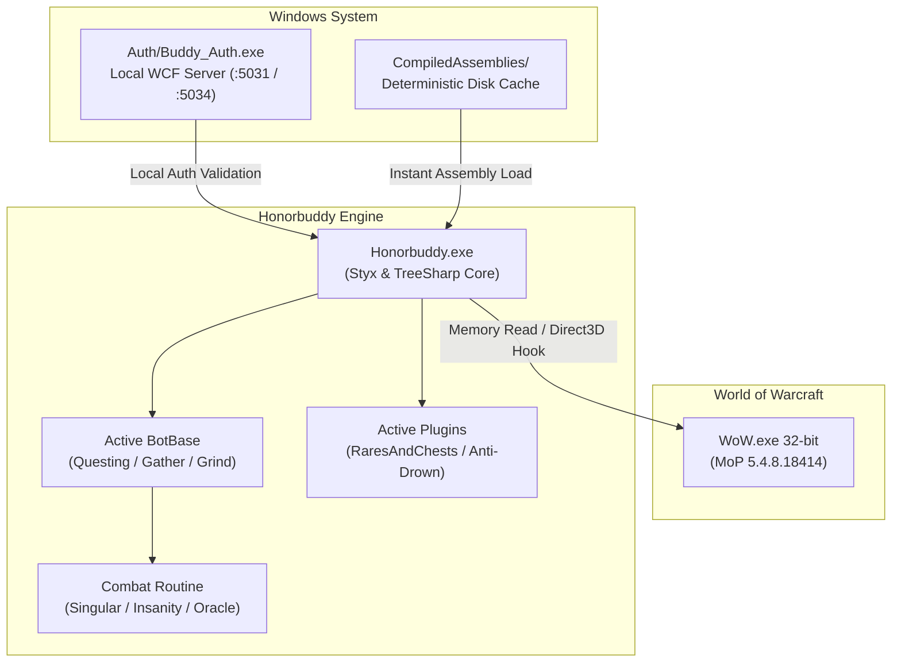

# Honorbuddy — World of Warcraft: Mists of Pandaria (5.4.8 Build 18414)

[-blue.svg)](#system-requirements)
[-orange.svg)](#system-requirements)
[](#prerequisites)
[](https://github.com/Likon69/Honorbuddy-MoP-5.4.8-18414)
[](#authors--credits)

The modernized, stabilized, and fully autonomous release of **Honorbuddy v2.5.11489.748** engineered for **World of Warcraft: Mists of Pandaria (Patch 5.4.8, Build 18414)**. 

This repository provides a self-contained automation and botting environment featuring standalone local authentication, high-performance deterministic assembly caching, an integrated non-destructive Routine Manager, hardened navigation blacklists, and a curated library of over 700 profiles, combat routines, and plugins.

---

## Table of Contents

- [Key Modernizations & Enhancements](#key-modernizations--enhancements)
- [System Requirements](#system-requirements)
- [Prerequisites](#prerequisites)
- [Installation & Quick Start Guide](#installation--quick-start-guide)
- [Architecture Overview](#architecture-overview)
- [Included BotBases](#included-botbases)
- [Combat Routines & Routine Manager](#combat-routines--routine-manager)
- [Plugins Suite](#plugins-suite)
- [Profile Ecosystem (1–90 Leveling & Gathering)](#profile-ecosystem-190-leveling--gathering)
- [High-Performance Assembly Caching](#high-performance-assembly-caching)
- [Repository Directory Structure](#repository-directory-structure)
- [Troubleshooting & FAQ](#troubleshooting--faq)
- [Documentation Index](#documentation-index)
- [Authors & Credits](#authors--credits)

---

## Key Modernizations & Enhancements

- ⚡ **Instant Startup & Assembly Caching (`CompiledAssemblies/`)**:
  - Replaces slow, repetitive runtime compilation with a deterministic disk-backed assembly cache.
  - Eliminates the 60–90 second startup freeze and client lockup, loading over 110 precompiled assemblies in under **100 milliseconds**.
  - Includes automated de-duplication (`SafeAddReference`) preventing fatal `CS1703` duplicate assembly reference errors during dynamic quest profile execution.
- 🛡️ **Self-Contained Offline Authentication (`Auth/Buddy_Auth.exe`)**:
  - Fully decoupled from defunct Bossland authentication servers.
  - Integrated local WCF service handling key validation, remote procedure calls, and local tilemesh distribution.
- 🔄 **Runtime Routine Manager Switcher**:
  - On-the-fly combat rotation switching directly via the main user interface button without restarting the bot or reloading the profile.
- 🧭 **Loot & Harvest Oscillation Fixes**:
  - Hardened `LevelBot` / `Questing` behavior trees to assert both unit loot and node blacklist flags (`BlacklistFlags.Loot | BlacklistFlags.Node`), preventing infinite loops between corpses and gatherable herbs/ore veins.
  - Sanitized third-party plugin navigation calls (`Plugins/RaresAndChests`, `Combat Looter`) to respect active behavior tree POIs and prevent spell-cast interruptions.
- 📦 **Modern .NET & Windows 10/11 Compatibility**:
  - IL-level fixes ensuring smooth execution on modern 64-bit Windows environments while maintaining 32-bit execution boundaries with the WoW client.

---

## System Requirements

| Component | Requirement |
|---|---|
| **Operating System** | Windows 7 SP1, Windows 8.1, Windows 10, or Windows 11 (64-bit supported; runs in 32-bit WOW64 mode) |
| **Game Client** | World of Warcraft: Mists of Pandaria **Patch 5.4.8 (Build 18414)** |
| **Client Architecture** | **32-bit `Wow.exe`** (*Required* — Honorbuddy cannot attach to 64-bit `Wow-64.exe`) |
| **Graphics API** | **DirectX 11** or **DirectX 9** (*Windowed* or *Windowed Fullscreen* mode recommended) |
| **User Privileges** | Administrator privileges (if WoW is elevated or installed in `Program Files`) |

---

## Prerequisites

Before launching Honorbuddy, ensure the following runtime libraries are installed on your system:

1. **[.NET Framework 4.5.1](https://dotnet.microsoft.com/download/dotnet-framework/net451)** or higher (e.g. .NET Framework 4.8 / 4.8.1, typically preinstalled on Windows 10/11).
2. **Microsoft Visual C++ Redistributable Packages (x86 / 32-bit)**:
   - 🌟 **Recommended (All-in-One)**: **[TechPowerUp Visual C++ Redistributable Runtimes All-in-One](https://www.techpowerup.com/download/visual-c-redistributable-runtime-package-all-in-one/)**
     - Extracts and installs every Visual C++ runtime version (2005, 2008, 2010, 2012, 2013, and 2015–2022) for both **x86** and **x64** in a single automated step via `install_all.bat`.
     - Prevents missing DLL errors (`MSVCR100.dll`, `MSVCR110.dll`, `MSVCR120.dll`, `VCRUNTIME140.dll`) required by native modules (`GreyMagic.dll`, `SlimDX.dll`, `Tripper.RecastManaged.dll`, and `RemoteASMNative.dll`).
   - **Manual Microsoft Standalone Installers** (if installing individually):
     - [Visual C++ 2010 SP1 Redistributable (x86)](https://www.microsoft.com/en-us/download/details.aspx?id=26999) *(Strictly required by SlimDX & GreyMagic)*
     - [Visual C++ 2012 Update 4 Redistributable (x86)](https://www.microsoft.com/en-us/download/details.aspx?id=30679)
     - [Visual C++ 2013 Redistributable (x86)](https://www.microsoft.com/en-us/download/details.aspx?id=40784)
     - [Visual C++ 2015–2022 Redistributable (x86)](https://aka.ms/vs/17/release/vc_redist.x86.exe)
3. **[DirectX End-User Runtimes (June 2010)](https://www.microsoft.com/en-us/download/details.aspx?id=8109)**:
   - Provides legacy DirectX 9 and DirectX 11 helper libraries (`d3dx9_43.dll`, `d3dx11_43.dll`) required by `SlimDX.dll` for game screen hooks and overlays. Windows 10 and 11 do not include these legacy DirectX components out of the box.

> [!IMPORTANT]
> **Strict 32-bit (x86) Requirement**:
> You **must** ensure the **x86 (32-bit)** versions of all runtimes are installed even on 64-bit Windows systems. Both `Wow.exe` (32-bit) and `Honorbuddy.exe` execute as 32-bit processes. Using the **TechPowerUp All-in-One** package is strongly advised as it installs both architectures automatically.

---

## Installation & Quick Start Guide

### Step 1: Network & Hosts Configuration
Redirect authentication server domains to your local loopback address by appending the following entries to `C:\Windows\System32\drivers\etc\hosts`:

```hosts
127.0.0.1 eu1.auth.buddyauth.com
127.0.0.1 eu2.auth.buddyauth.com
127.0.0.1 eu3.auth.buddyauth.com
```

### Step 2: Start the Authentication Server
Navigate to the `Auth/` folder and launch:
```bat
Auth\Buddy_Auth.exe
```
Keep this window open while running Honorbuddy. *(For background service installation via NSSM, refer to [docs/Buddy-Auth-Server.md](docs/Buddy-Auth-Server.md)).*

### Step 3: Launch World of Warcraft
1. Launch the 32-bit client: `Wow.exe` (MoP 5.4.8 Build 18414).
2. Verify game settings:
   - **System -> Graphics -> Window Mode**: *Windowed* or *Windowed (Fullscreen)*.
   - **System -> Advanced -> Graphics API**: *DirectX 11* or *DirectX 9*.
3. Log into your character and enter the world.

### Step 4: Launch Honorbuddy
1. Run `Honorbuddy.exe` (as Administrator if required).
2. When prompted for an authentication key, enter:
   ```text
   12345678901234567890
   ```
3. Honorbuddy will attach to the active `Wow.exe` process, load all cached assemblies instantly, and present the main interface.

### Step 5: Select BotBase & Profile
1. Select your desired **BotBase** from the drop-down menu (e.g., `Questing`, `Gatherbuddy2`, `Grind Bot`, `Combat`).
2. Click **Load Profile** and select a profile from the `Default Profiles/` directory.
3. Select your active combat routine using the **Routine** menu or the **Routine Manager** button.
4. Click **Start**.

---

## Architecture Overview



---

## Included BotBases

Honorbuddy includes a complete collection of behavior-tree-driven BotBases located in the `Bots/` folder:

| BotBase | Purpose & Features |
|---|---|
| **Questing** | Fully automated quest progression, dynamic quest behaviors, vehicle mechanics, and turn-ins. Powered by Kick's 1–90 profile pack. |
| **Gatherbuddy2** | High-efficiency herb and ore farming with flying mount navigation, obstacle avoidance, node blacklisting, and auto-shuffler support. |
| **Grind Bot** | Dedicated mob grinding for experience, cloth, rep, and loot with hotspot loops and vendor routes. |
| **ProfessionBuddy** | Advanced multi-step automation: trade skills, crafting sequences, material farming, mail management, and AH interaction. |
| **DungeonBuddy** | Automated 5-man dungeon and LFR instance farming with boss mechanics handling, role management (Tank/Healer/DPS), and queue automation. |
| **BGBuddy** | Player-versus-Player (PvP) automation across all MoP battlegrounds (Warsong Gulch, Arathi Basin, Eye of the Storm, Strand, Alterac Valley, Isle of Conquest, Temple of Kotmogu, Silvershard Mines). |
| **FishingBuddy / AutoAngler2** | Automated fishing with pool detection, lure application, equipment swapping, and bait management. |
| **Combat / Enyo / RaidBot / LazyRaider** | Manual movement and positioning with automated, high-performance combat rotations (ideal for raiding, heroic dungeons, and manual PvP). |
| **Tyrael** | Passive combat assistance and automation tailored for high-end raiding. |

---

## Combat Routines & Routine Manager

Honorbuddy utilizes class-specific Combat Routines (CCs) located in `Routines/`.

### Featured Routines
- **Singular v3.0**: Comprehensive all-in-one routine supporting every class and specialization in 5.4.8. Modernized with GCD compensation and Holy Priest fixes.
- **Insanity Premium [Millz]**: Elite Priest rotation supporting Shadow, Discipline, and Holy with advanced burst toggles and defensive cooldown management.
- **Oracle / Pure / Magitek / Tuha / Vitalic**: Specialized PvP and PvE routines optimized for high-tier arenas and heroic raiding.

### Non-Destructive Routine Manager
Click the **Routine Manager** button on the main UI window to dynamically re-evaluate and swap combat routines without interrupting bot execution or reloading questing profiles.

---

## Plugins Suite

All plugins are modular C# components located in `Plugins/`:

- **RaresAndChests**: Scans for rare elites and treasure chests, safely routing movements through the POI engine without interrupting herb/ore gathering.
- **Anti-Drown**: Automatically surfaces the character when breath is low.
- **Refreshment**: Configurable eating, drinking, and buff maintenance out of combat.
- **Combat Looter & NoCombat Looter**: Intelligent corpse looting with active-POI collision protection.
- **Auto-Equip / ItemRoll**: Automated quest reward selection, gear upgrades, and dungeon loot rolling.
- **Pokehbuddy**: Full pet battle leveling and wild pet capture automation.
- **TidyBags**: Automated inventory management, bag sorting, and junk vendoring.

---

## Profile Ecosystem (1–90 Leveling & Gathering)

This repository includes over **700 curated XML profiles** organized in `Default Profiles/`:

- **Kick's Mega Profile Pack 1–90**:
  - Complete 1–85 Classic, The Burning Crusade, Wrath of the Lich King, and Cataclysm paths.
  - Complete 85–90 Mists of Pandaria questing storylines (Jade Forest, Valley of the Four Winds, Kun-Lai Summit, Townlong Steppes, Dread Wastes).
  - Dedicated Alliance and Horde Auto-Loaders.
- **GatherBuddy2 Zone Profiles**: Comprehensive mining and herbalism routes across all continents.
- **ProfessionBuddy Scripts**: Complete 1–600 tradeskill leveling profiles for Inscription, Alchemy, Blacksmithing, Jewelcrafting, Engineering, and Tailoring.

For instructions on authoring or modifying profiles, refer to [docs/Profiles-Guide.md](docs/Profiles-Guide.md).

---

## High-Performance Assembly Caching

To prevent severe 60+ second startup freezes and client lockups during initial launch and profile changes, this build features **Assembly Caching** in `Honorbuddy.exe`:

- Precompiled binaries are stored deterministically in [`CompiledAssemblies/`](CompiledAssemblies/).
- On startup, the engine calculates a content-addressed hash of all source files and compiler options.
- If sources have not changed, the binary assembly is loaded directly from disk via native CLR assembly loading in **<100ms**.
- If any `.cs` file in `Bots/`, `Routines/`, `Plugins/`, or `Quest Behaviors/` is modified, the compiler automatically invalidates the cache and recompiles only the affected assembly.
- Built-in reference deduplication prevents compiler error `CS1703` when handling shared GAC assemblies like `System.Runtime.Caching.dll`.

---

## Repository Directory Structure

```text
Honorbuddy-MoP-5.4.8-18414/
├── Auth/                        # Local Authentication & Mesh Tile Server
│   ├── Buddy_Auth.exe           # Standalone local auth server
│   └── Mesh/HB2/                # Pre-cached 3D navigation tilemaps (.etm / .tilemap)
├── Bots/                        # Behavior Tree BotBases (Questing, Gatherbuddy2, etc.)
├── CompiledAssemblies/          # High-performance cached DLL binaries
├── Configuration/               # Default XML configuration templates
├── Default Profiles/            # 700+ Questing, Gathering, and Profession profiles
│   ├── 1-90 Questing Profile Pack/ # Kick's complete Alliance & Horde leveling packs
│   ├── GatherBuddy2/            # Mining & Herbalism routes
│   └── ProfessionBuddy/         # Tradeskill leveling profiles
├── docs/                        # Complete technical documentation & wiki
├── Help/                        # Documentation and offline help assets
├── Logs/                        # Runtime diagnostic and session logs
├── Plugins/                     # Modular plugins (Rares, Anti-Drown, Looters, etc.)
├── Quest Behaviors/             # Specialized C# behaviors for complex quest mechanics
├── Routines/                    # Combat routines (Singular, Insanity, Oracle, etc.)
├── Settings/                    # Global settings and character-specific configurations
├── Honorbuddy.exe               # Main bot executable (patched & modernized)
└── README.md                    # Repository documentation
```

---

## Troubleshooting & FAQ

### 1. "Could not attach to process / Process not found"
- **Cause**: World of Warcraft is running as 64-bit (`Wow-64.exe`).
- **Solution**: Launch the 32-bit executable (`Wow.exe`). You can create a desktop shortcut directly to `Wow.exe` with `-no-launcher`.

### 2. "DirectX / Hook Error or Client Crash on Attach"
- **Cause**: Graphics API incompatibility or third-party overlay interference (Discord, RivaTuner, GeForce Experience).
- **Solution**:
  - In WoW, set Graphics API to **DirectX 11** or **DirectX 9** (*System -> Advanced -> Graphics API*).
  - Set Display Mode to **Windowed** or **Windowed (Fullscreen)**.
  - Disable third-party game overlays.

### 3. "Authentication Failed / Server Connection Refused"
- **Cause**: `Buddy_Auth.exe` is not running or the hosts file redirect is missing.
- **Solution**: Ensure `Auth/Buddy_Auth.exe` is started and verify that `127.0.0.1 eu1.auth.buddyauth.com` is present in `C:\Windows\System32\drivers\etc\hosts`.

### 4. "Bot oscillates or runs back and forth between dead mobs and herbs"
- **Cause**: Older plugin version or outdated binary without node blacklist alignment.
- **Solution**: Ensure you are using the latest `Honorbuddy.exe` with `smethod_62` patched for `BlacklistFlags.Loot | BlacklistFlags.Node` and that `CombatLooter` inside `Plugins/RaresAndChests` is disabled.

### 5. "Missing Navigation Meshes / Cannot Navigate"
- **Cause**: Tilemaps for the current zone are missing from the mesh cache.
- **Solution**: Ensure the mesh files are present in `Auth/Mesh/HB2/` or allow Honorbuddy to download them through the local Auth server. Meshes can also be placed in `%LocalAppData%\Bossland\Honorbuddy\Meshes\`.

### 6. "System.DllNotFoundException / Missing MSVCR*.dll or D3DX*.dll on Launch"
- **Cause**: Missing 32-bit (x86) Visual C++ redistributable runtimes or legacy DirectX 9/11 libraries required by `SlimDX.dll` and `GreyMagic.dll`.
- **Solution**:
  - Download and run the **[TechPowerUp Visual C++ All-in-One](https://www.techpowerup.com/download/visual-c-redistributable-runtime-package-all-in-one/)** installer (`install_all.bat` as Administrator).
  - Install the **[DirectX End-User Runtimes (June 2010)](https://www.microsoft.com/en-us/download/details.aspx?id=8109)** to restore missing `d3dx9_43.dll` / `d3dx11_43.dll`.

---

## Documentation Index

Comprehensive guides and architectural references are available in the [`docs/`](docs/) directory:

- [**Home & System Architecture**](docs/Home.md)
- [**Installation & Client Setup**](docs/Installation-&-Setup.md)
- [**Local Auth Server Configuration & NSSM Service**](docs/Buddy-Auth-Server.md)
- [**BotBases Detailed Guide**](docs/BotBases-Overview.md)
- [**Routine Manager & Combat Routines**](docs/Routine-Manager-&-Combat-Routines.md)
- [**Profiles Writing & XML Reference**](docs/Profiles-Guide.md)
- [**Global & Character Configuration**](docs/Configuration-&-Settings.md)
- [**Styx API & Developer Reference**](docs/API-&-Development-Reference.md)

---

## Authors & Credits

### Original Authors
- **Bossland GmbH**: Original creators of Honorbuddy, Styx API, and the TreeSharp behavior engine (Apoc, Nesox, Hawker, and the Bossland development team).

### Upstream Repository & Packaging
- **[Likon69 (Téxy)](https://github.com/Likon69/Honorbuddy-MoP-5.4.8-18414)**: Creator and maintainer of the base upstream repository ([Likon69/Honorbuddy-MoP-5.4.8-18414](https://github.com/Likon69/Honorbuddy-MoP-5.4.8-18414)), who preserved, packaged, and initially published this working 5.4.8 release.

### Core Contributors & Reverse Engineering
- **Vo1d, Err0r, Manjaro**: Core reverse engineering, authentication server emulation (Buddy_Auth.exe), binary patching, and fork stabilization for World of Warcraft 5.4.8 (Build 18414).

### Profile, Routine & Plugin Developers
Many thanks to the community developers of Honorbuddy content whose profiles, routines, and plugins make this bot possible:
- **Kickazz006**, **Akna**, **Brodie**, **Cava**, **Vitalic**, **Twist**, **Echo**, **Millz**, and the wider community creators.

---

> [!WARNING]
> This software is intended strictly for educational, research, and private server gameplay purposes. Use on official retail or commercial servers violates terms of service.
