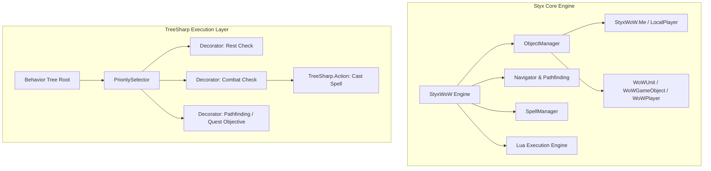

# API & Development Reference

Honorbuddy's core engine is built on two primary libraries:
1. **Styx.dll**: The object-mapping and memory-interaction API for World of Warcraft.
2. **TreeSharp.dll**: A lightweight, high-performance behavior-tree execution library.

This reference provides developers with an overview of core namespaces, classes, behavior tree design, and custom script authoring.

---

## Architecture Overview



---

## 1. Core Engine Namespaces

### `Styx`
- **`StyxWoW`**: Static entry point representing the active game state.
  - `StyxWoW.Me`: Represents the local player character (`LocalPlayer`). Exposes health, mana/rage/energy/focus, location coordinates, buffs, debuffs, current target, pet, and combat status.
  - `StyxWoW.IsInGame`: `Boolean` indicating whether the client is past character select and inside the world.
  - `StyxWoW.Memory`: Direct handle to the GreyMagic memory manipulation engine for reading/writing WoW memory structures.

### `Styx.WoWInternals`
- **`ObjectManager`**: Enumerate all active game objects currently rendered or tracked in memory within the client's visibility sphere.
  - `ObjectManager.GetObjectsOfType<T>()`: Retrieves lists of `WoWUnit`, `WoWPlayer`, `WoWGameObject`, `WoWCorpse`, or `WoWItem`.
  - `ObjectManager.Update()`: Flushes and refreshes the internal object cache.
- **`Lua`**: Direct execution of in-game World of Warcraft Lua code without UI taint restrictions.
  - `Lua.DoString("string script")`: Executes Lua commands inside the WoW environment.
  - `Lua.GetReturnVal<T>("string script", int returnIndex)`: Evaluates a Lua expression and marshals the result into a typed C# variable.

### `Styx.CommonBot`
- **`SpellManager`**: Checks availability and casts spells:
  - `SpellManager.CanCast(string name)` / `SpellManager.CanCast(int spellId)`
  - `SpellManager.Cast(string name)` / `SpellManager.Cast(WoWUnit target)`
  - `SpellManager.GlobalCooldown`: Checks if the GCD is currently ticking.
- **`RoutineManager`**: Discovers, loads, and manages `ICombatRoutine` instances.
- **`BotManager`**: Registers and coordinates the active `BotBase`.

### `Styx.Pathing`
- **`Navigator`**: The high-level pathfinding interface:
  - `Navigator.MoveTo(Vector3 destination)`: Calculates a path across loaded navigation meshes and moves the character toward the target.
  - `Navigator.AtLocation(Vector3 destination)`: Returns `true` if the player has arrived within acceptable distance.
  - `Flightor`: Handles 3D aerial flight pathfinding when mounted on a flying mount.

---

## 2. TreeSharp Behavior Tree Patterns

TreeSharp structures logic as a hierarchy of nodes evaluated repeatedly on every bot tick.

### Core TreeSharp Nodes

| Node | Behavior |
|---|---|
| **`PrioritySelector`** | Evaluates children from left to right (top to bottom). Runs the first child that returns `Success` or `Running`. Stops evaluation of subsequent children for that tick. |
| **`Sequence`** | Runs children sequentially in order. If any child returns `Failure`, the entire sequence aborts and returns `Failure`. |
| **`Decorator`** | Acts as an `if` gate. Evaluates a condition delegate (`CanRun`). If `true`, executes its child node; if `false`, returns `Failure`. |
| **`Action`** | A leaf node that performs a concrete action (casts a spell, moves the player, interacts with an NPC). |

### Return Statuses (`RunStatus`)
- **`RunStatus.Success`**: The node completed its action successfully.
- **`RunStatus.Failure`**: The node could not execute or its condition was not met.
- **`RunStatus.Running`**: The action has started but needs multiple ticks to complete (e.g. channeling a spell or running toward a destination).

### Example TreeSharp Construction

```csharp
using Styx;
using Styx.CommonBot;
using Styx.TreeSharp;
using Action = Styx.TreeSharp.Action;

public static Composite CreateCombatLogic()
{
    return new PrioritySelector(
        // Ensure we have a valid alive enemy target
        new Decorator(ret => StyxWoW.Me.CurrentTarget == null || StyxWoW.Me.CurrentTarget.IsDead,
            new Action(ret => RunStatus.Failure)),

        // Face the target if not facing
        new Decorator(ret => !StyxWoW.Me.IsFacing(StyxWoW.Me.CurrentTarget),
            new Action(ret => {
                StyxWoW.Me.CurrentTarget.Face();
                return RunStatus.Success;
            })),

        // Defensive: Cast Ice Barrier if low on health
        new Decorator(ret => StyxWoW.Me.HealthPercent < 30 && SpellManager.CanCast("Ice Barrier"),
            new Action(ret => SpellManager.Cast("Ice Barrier"))),

        // Offensive: Cast Frostbolt
        new Decorator(ret => SpellManager.CanCast("Frostbolt"),
            new Action(ret => SpellManager.Cast("Frostbolt")))
    );
}
```

---

## 3. Developing Custom Quest Behaviors

Custom Quest Behaviors allow XML profiles to perform custom C# actions during quest progression.

All behaviors inherit from `CustomForcedBehavior`:

```csharp
using Styx.CommonBot.Profiles;
using Styx.TreeSharp;
using Styx.WoWInternals;

namespace Honorbuddy.Quest_Behaviors.MyCustomBehavior
{
    [CustomBehaviorFileName(@"MyCustomBehavior")]
    public class MyCustomBehavior : CustomForcedBehavior
    {
        public MyCustomBehavior(Dictionary<string, string> args) : base(args)
        {
            // Parse XML attributes passed from the profile
            MobId = GetAttributeAsNullable<int>("MobId", false, ConstrainAs.MobId, null) ?? 0;
        }

        public int MobId { get; private set; }
        private bool _isDone;

        public override bool IsDone => _isDone;

        public override void OnStart()
        {
            // Called once when behavior becomes active
            _isDone = false;
        }

        protected override Composite CreateBehavior()
        {
            return new PrioritySelector(
                // Perform actions until goal is satisfied, then set _isDone = true
            );
        }
    }
}
```

Usage in an XML profile:
```xml
<CustomBehavior File="MyCustomBehavior" MobId="12345" />
```
