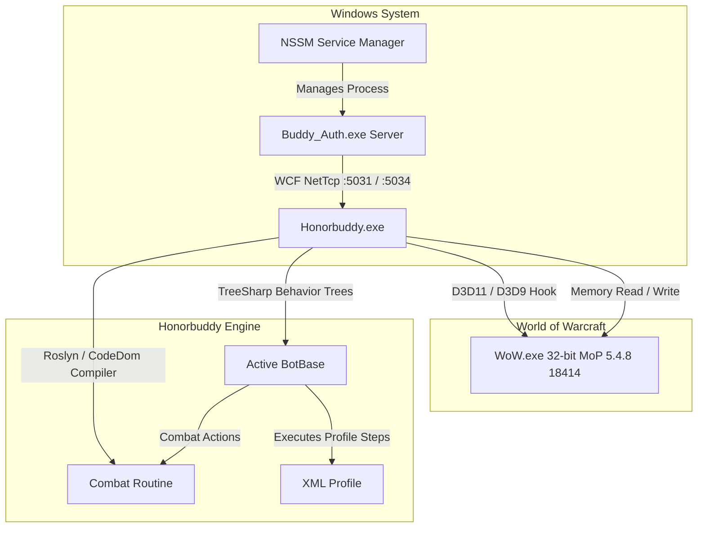

# Honorbuddy v2.5.11489.748 for WoW MoP 5.4.8 (18414)

Welcome to the comprehensive documentation for **Honorbuddy v2.5.11489.748**, tailored and patched specifically for **World of Warcraft: Mists of Pandaria (5.4.8, Build 18414)**.

---

## Overview

Honorbuddy is an extensible, behavior-tree-driven automation platform for World of Warcraft. Built on the proprietary **TreeSharp** execution engine and the **Styx** API layer, Honorbuddy injects cleanly into the 32-bit DirectX WoW client to provide pathfinding, combat automation, quest progression, profession skilling, dungeon/raid mechanics handling, and battleground management.

This release has been updated, de-obfuscated, and stabilized for private and local MoP 5.4.8 servers. It includes an integrated offline authentication server (`Buddy_Auth.exe`), IL-level assembly fixes, dynamic compiler support for modern .NET runtimes, a non-destructive Combat Routine manager, and a curated library of over 700 unified profiles.

---

## Quick Navigation

| Topic | Description |
|---|---|
| [[Buddy Auth Server|Buddy-Auth-Server]] | Architecture, WCF NetTcp ports, offsets, meshes, and NSSM Windows Service installation |
| [[Installation & Setup|Installation-&-Setup]] | Client prerequisites, 32-bit WoW launch flags, DirectX modes, and first-time run guide |
| [[Routine Manager & Combat Routines|Routine-Manager-&-Combat-Routines]] | Dynamic routine switching, Singular, Demonic, Gladiator Suite, and rotation customization |
| [[BotBases Overview|BotBases-Overview]] | Questing, BGBuddy, DungeonBuddy, GatherBuddy2, ProfessionBuddy, Tyrael, and AutoAngler2 |
| [[Profiles Guide|Profiles-Guide]] | Profile XML structure, 1–90 leveling routes, gathering paths, and profession scripts |
| [[Configuration & Settings|Configuration-&-Settings]] | Global configuration, character settings, frame locking, and hardware performance |
| [[API & Development Reference|API-&-Development-Reference]] | Styx architecture, TreeSharp behaviors, CustomForcedBehavior guide, and Lua execution |

---

## Architecture at a Glance

---

## System Requirements

- **Client**: World of Warcraft client version 5.4.8 (Build 18414).
- **Executable**: 32-bit `WoW.exe` (Honorbuddy attaches exclusively to 32-bit processes).
- **Graphics API**: Direct3D 11 or Direct3D 9 (configured in WoW System > Advanced).
- **Operating System**: Windows 7 SP1, 8.1, 10, or 11 (x64 compatible).
- **Runtimes**:
  - Microsoft .NET Framework 4.5.1 or newer (4.8 recommended).
  - Microsoft Visual C++ 2010, 2012, 2013, 2015–2022 Redistributable Packages (x86).
  - DirectX End-User Runtimes (June 2010).

---

## Key Highlights of this Build

1. **Standalone Offline Authentication**:
   - Zero reliance on external Bossland authentication or Tripwire anti-cheat verification servers.
   - Self-hosted local WCF service handles authentication, offset delivery, and navmesh tiles.
   - Fully compatible with deployment as a resilient background Windows Service using `nssm.exe`.

2. **Hot-Swappable Routine Manager**:
   - The GUI features a dedicated **Routine Manager** button.
   - Pop and switch between available combat routines on the fly without wiping active bot memory or requiring bot restarts.

3. **Dynamic Compilation Fixes**:
   - Fixed `CS0012: The type 'System.Attribute' is defined in an assembly that is not referenced` errors by auto-injecting runtime assembly dependencies (`System.Runtime.dll`, `System.Runtime.Caching.dll`) into `CodeCompiler`.
   - Eliminates compilation failures across complex class routines and quest behaviors.

4. **Curated & Unified Profiles**:
   - Complete 1–90 leveling suite for both Alliance and Horde.
   - Clean, standardized directory structure with obsolete and broken files purged.
