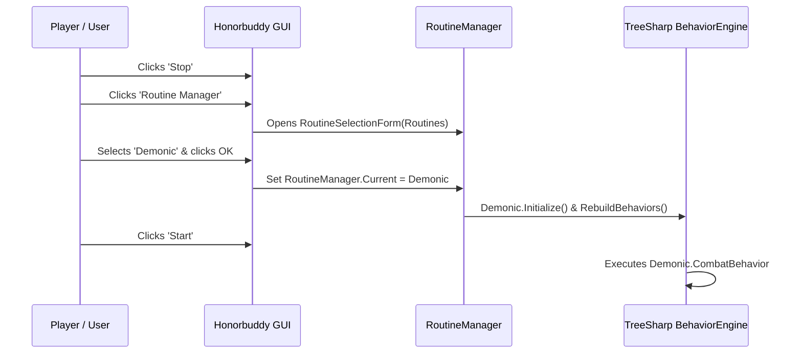

# Routine Manager & Combat Routines

Combat Routines (CRs) are specialized assemblies that control how your character fights, heals, buffs, pulls, and rests. While a **BotBase** decides *where* to go and *what* objectives to complete, the **Combat Routine** decides *how* your character acts in combat on every tick of the behavior tree.

---

## The Routine Manager

Historically in Honorbuddy, switching your active combat routine required restarting the application or invoking full assembly reloads that could invalidate active hooks.

In this patched release:
- The main window features a dedicated **Routine Manager** button.
- Clicking the button pops the `RoutineSelectionForm` populated with all currently loaded and compiled routines compatible with your character's class.
- You can switch from a PvE leveling rotation (e.g., **Singular**) to a specialized raid rotation (e.g., **Demonic**) or a PvP routine (e.g., **Gladiator Suite**) seamlessly in seconds without restarting the bot.



---

## Dynamic Compilation & The CS0012 Fix

When routines and plugins are loaded from source files in the `Routines\` and `Plugins\` directories, Honorbuddy compiles them dynamically into memory using `Styx.Common.AssemblyLoader` and `CodeCompiler`.

### The CS0012 Error
On modern .NET 4.5+ runtimes, compiled routines referencing portable libraries or facade assemblies frequently crashed with:
```
Compiler Error: error CS0012: The type 'System.Attribute' is defined in an assembly that is not referenced. You must add a reference to assembly 'System.Runtime, Version=4.0.0.0, Culture=neutral, PublicKeyToken=b03f5f7f11d50a3a'.
```

### The Engine Patch
`CodeCompiler..ctor` was patched at the IL/engine level to automatically inject explicit reference paths to:
- `System.Runtime.dll`
- `System.Runtime.Caching.dll`

All dynamic compilations across Singular, Demonic, Gladiator Suite, and custom user routines now compile cleanly on Windows 10 and 11 without manual DLL copying or csproj modification.

---

## Bundled Combat Routines

### 1. Singular
**Singular** is the official all-in-one combat routine supporting all 11 classes and all 34 talent specializations in Mists of Pandaria.

- **Class Support**:
  - **Death Knight**: Blood, Frost, Unholy
  - **Druid**: Balance, Feral, Guardian, Restoration
  - **Hunter**: Beast Mastery, Marksmanship, Survival
  - **Mage**: Arcane, Fire, Frost
  - **Monk**: Brewmaster, Mistweaver, Windwalker
  - **Paladin**: Holy, Protection, Retribution
  - **Priest**: Discipline, Holy, Shadow
  - **Rogue**: Assassination, Combat, Subtlety
  - **Shaman**: Elemental, Enhancement, Restoration
  - **Warlock**: Affliction, Demonology, Destruction
  - **Warrior**: Arms, Fury, Protection
- **Configuration Features**:
  - Pull distance configuration per spec
  - Rest health and mana thresholds (eating and drinking rules)
  - Automatic pet summoning, healing, and buff maintenance
  - Target switching and AoE crowd handling

### 2. Demonic
**Demonic** is a dedicated, elite Warlock combat routine designed specifically for MoP:

- **Destruction**:
  - Immolate dot management, Conflagrate charge cycling, Incinerate filling
  - Chaos Bolt burst timing during Dark Soul and trinket procs
  - Automatic Havoc targeting on secondary enemies
  - Rain of Fire passive shard generation management
- **Demonology**:
  - Demonic Fury generation and Metamorphosis spend optimization
  - Doom dot refresh during peak procs, Hand of Gul'dan 2-stack debuff timing
  - Imp swarm and Wild Imp synergy
- **Affliction**:
  - Agony, Corruption, and Unstable Affliction rolling
  - Soulburn: Soul Swap mechanics
  - Haunt debuff uptime optimization and Drain Soul execute snipe

### 3. Gladiator Suite
**Gladiator Suite** is an advanced PvP-oriented combat routine suite tailored for Arenas (2v2, 3v3, 5v5) and Rated Battlegrounds (RBGs):

- **Target Prioritization**: Prioritizes low-health, non-immune enemy players over pets and totems.
- **Smart Interrupts**: Human-like interrupt delays (100–350ms) to bypass fake-casting / juking.
- **Defensive Rotation**: Automatic trinket, healthstone, defensive cooldown usage based on incoming enemy burst and crowd control.
- **Burst Windows**: Synchronizes offensive cooldowns with crowd control on enemy healers.

### 4. Tyrael / Templar
Combat-assist engines designed for players who prefer to manually steer and position their character while the bot executes pixel-perfect combat rotations:
- Auto-faces target (optional)
- Automatically weaves instant-casts, procs, and off-GCD abilities
- Ideal for high-end raiding (Siege of Orgrimmar, Throne of Thunder).

---

## Creating a Custom Combat Routine

Every Honorbuddy combat routine inherits from `Styx.CommonBot.Routines.CombatRoutine` and implements the `ICombatRoutine` interface:

```csharp
using Styx;
using Styx.CommonBot.Routines;
using Styx.TreeSharp;

public class MyCustomRoutine : CombatRoutine
{
    public override string Name => "My Custom Routine";
    public override WoWClass Class => WoWClass.Warrior;

    public override void Initialize()
    {
        // One-time initialization logic
    }

    public override Composite CombatBehavior
    {
        get
        {
            return new PrioritySelector(
                // TreeSharp priority selector executing highest priority valid action
                new Decorator(ret => StyxWoW.Me.CurrentTarget == null, new Action(ret => RunStatus.Failure)),
                new Decorator(ret => SpellManager.CanCast("Execute"), new Action(ret => SpellManager.Cast("Execute"))),
                new Decorator(ret => SpellManager.CanCast("Mortal Strike"), new Action(ret => SpellManager.Cast("Mortal Strike"))),
                new Decorator(ret => SpellManager.CanCast("Slam"), new Action(ret => SpellManager.Cast("Slam")))
            );
        }
    }

    public override Composite PullBehavior
    {
        get
        {
            return new PrioritySelector(
                new Decorator(ret => SpellManager.CanCast("Charge"), new Action(ret => SpellManager.Cast("Charge")))
            );
        }
    }
}
```
Place your source files in `Routines\[RoutineName]\` and Honorbuddy will compile them at launch.
